# 에코체크 (Eco Check)

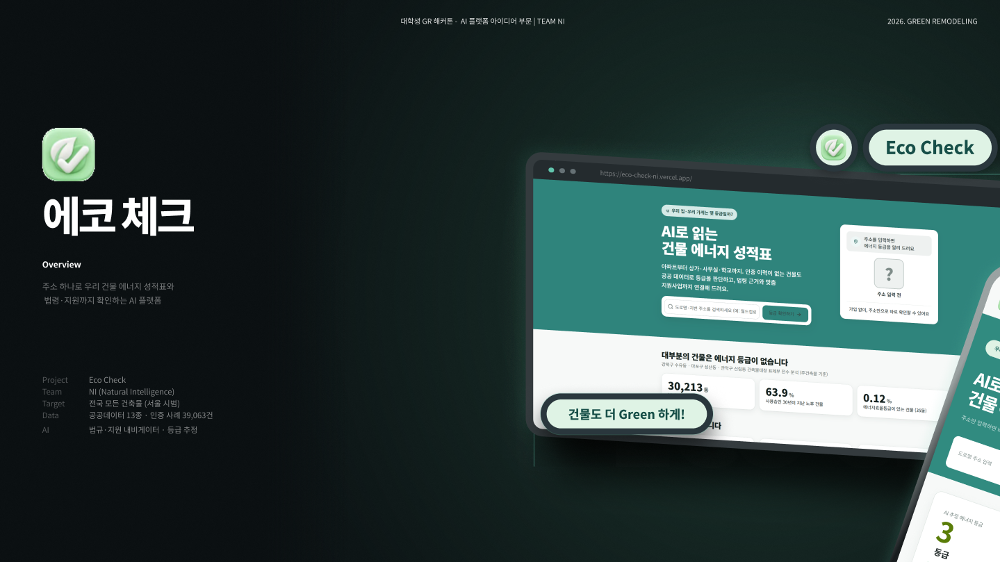

> 주소 하나로 우리 건물의 **에너지 성적표**를 확인하고, 적용되는 **법령·지원사업**을 원문 근거와 함께 안내받는 그린리모델링 플랫폼

제6회 그린리모델링 챌린지 대학생 해커톤 **AI 플랫폼 아이디어 부문** 출품작입니다.

**Live Demo** · https://eco-check-ni.vercel.app

<br>

## 문제 정의

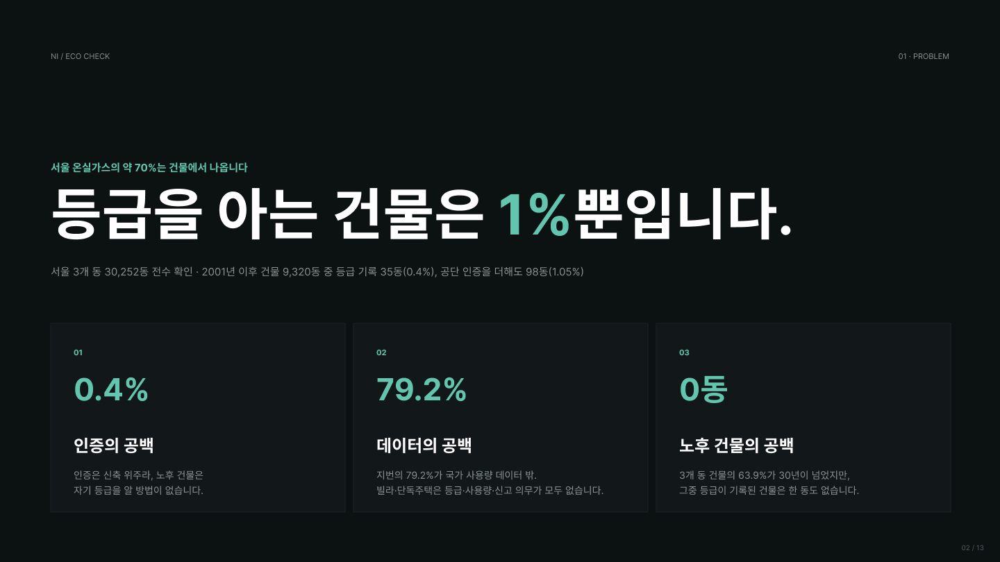

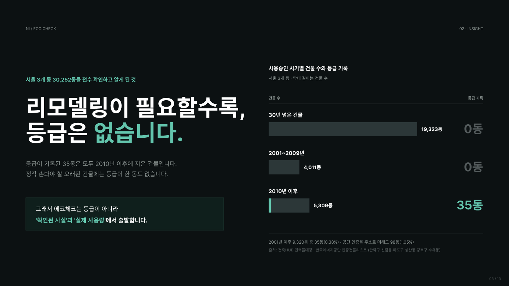

<br>

## 해결 방법

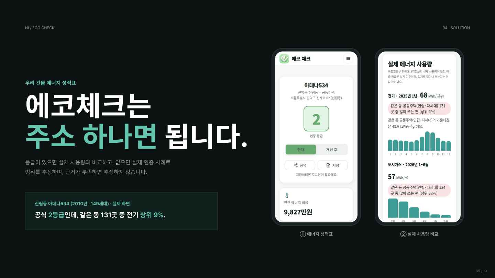

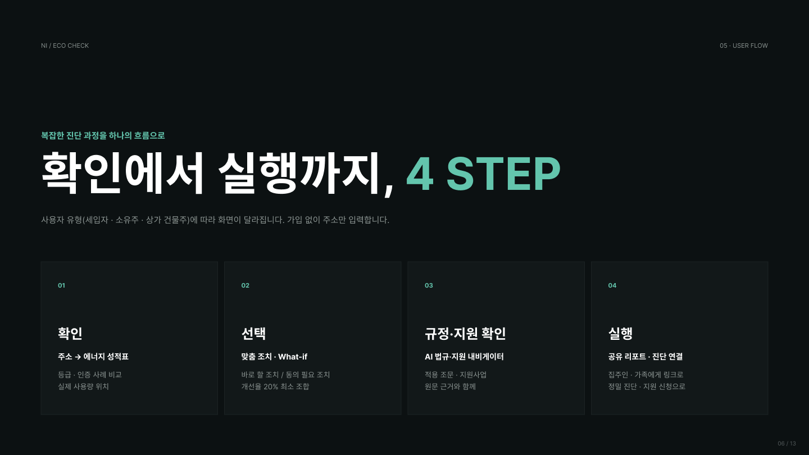

<br>

## 핵심 원칙

- **근거가 있으면 보여주고, 없으면 추정하지 않습니다.** 건축물대장에 등급이 있으면 그대로, 검증 오차가 기준을 넘는 건물은 "추정 안 함"으로 답합니다.
- **AI 답변에는 원문 근거를 붙입니다.** 법령·지원사업 답변은 수집한 법령·공고 코퍼스에서 찾은 조문과 함께 보여줍니다.
- **AI가 없어도 동작합니다.** Gemini 키가 없거나 할당량이 끝나면 규칙 기반 답으로 대체합니다.

<br>

## 주요 기능

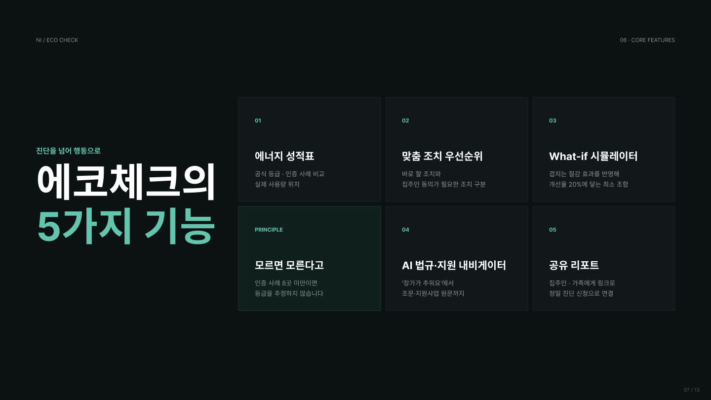

| 화면 | 경로 | 설명 |
| --- | --- | --- |
| 홈 · 주소 검색 | `/`, `/search` | 카카오 우편번호 검색으로 건물을 찾고, 목록에 없으면 간단한 정보로 추정 요청 |
| 에너지 성적표 | `/report/[buildingId]` | 에너지효율등급(실제/추정/범위), 같은 조건 건물 대비 등급 분포, 에너지 사용량·비용 |
| 개선하기 | `/guide/[buildingId]` | 건물에 맞는 개선 항목 체크리스트, What-if 시뮬레이터(창호·단열 등 적용 시 절감 예측), AI 리모델링 리포트 |
| 지원사업 | `/programs` | 그린리모델링 지원사업 탐색·필터, AI 법규·지원 내비게이터 |
| 서비스 소개 | `/about` | 사용 데이터 출처와 등급 추정 방식 설명 |
| 마이페이지 · 관리자 | `/mypage`, `/admin` | 저장한 건물·신청 내역·알림, 신청 관리 (목 데이터) |

<br>

## 기술 스택

| 영역 | 사용 기술 |
| --- | --- |
| 프론트엔드 | Next.js 16 (App Router), React 19, TypeScript, Tailwind CSS 4, MSW |
| 백엔드 | Spring Boot 4.1, Java 21 (Docker) |
| 모델 | Python, scikit-learn GradientBoosting |
| AI | Google Gemini API |
| 외부 API | 카카오 지도·우편번호, 국토교통부 건축HUB, 공공데이터포털, 국가법령정보 공동활용 |
| 배포 | Vercel (프론트), Render (백엔드) |

<br>

## 아키텍처

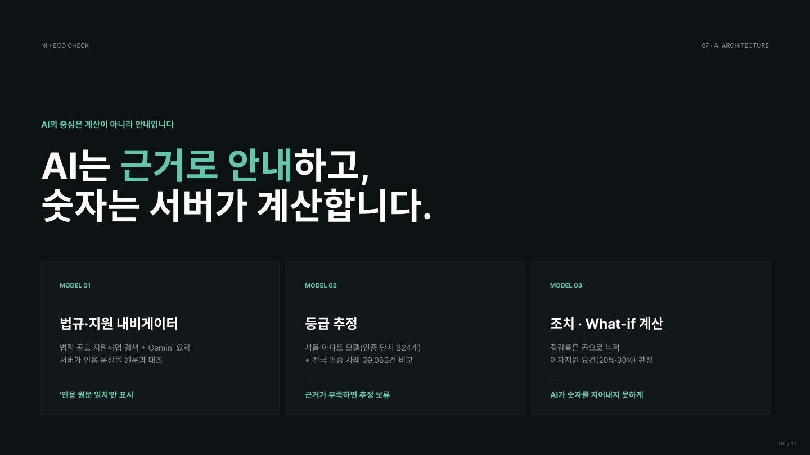

```
 브라우저 (Next.js)
   │
   ├─ /api/* Route Handlers ── Gemini (법규 내비게이터, 리모델링 리포트, 역할별 조언)
   │                       └─ 건축HUB (건축물대장 표제부 조회)
   │
   └─ beec (Spring Boot) ──── seed.json         건물 에너지 데이터 35,521건
                         ├── model.json        아파트 단지별 예측값 · 시기별 판정
                         └── seoul-apartments.json
```

`beec`는 시작할 때 JSON 데이터를 메모리에 올려 두고 조회만 합니다. 모델은 서버에서 실행하지 않고, `model/train.py`가 미리 계산한 결과를 읽습니다.

<br>

## 폴더 구조

```
.
├── src/
│   ├── app/                Next.js 페이지와 API Route Handlers
│   ├── components/
│   │   ├── ui/             공통 UI (Button, Dialog, Tabs …)
│   │   ├── layout/         AppBar, Footer, 네비게이션
│   │   └── domain/         등급 배지, 지역 지도, AI 리포트 등 도메인 컴포넌트
│   ├── data/               법령·지원사업 코퍼스, 인증 사례, 정적 데이터
│   ├── lib/                API 클라이언트, 법령 검색, What-if 계산 등
│   └── mocks/              MSW 핸들러
├── beec/                   Spring Boot 백엔드 (건물·에너지 매칭, 등급 추정 게이트)
├── model/                  등급 추정 모델 학습 코드와 검증 보고
├── scripts/                공공데이터 수집 스크립트 (법령, 지원사업, 가스 사용량 등)
└── public/                 정적 파일
```

<br>

## 시작하기

### 요구 사항

- Node.js 20 이상
- JDK 21 (Maven Wrapper 포함, 별도 설치 불필요)
- Python 3 (모델을 다시 학습할 때만)

### 1. 백엔드 실행 (기본 포트 8080)

```bash
cd beec
./mvnw spring-boot:run        # Windows: .\mvnw.cmd spring-boot:run
```

데이터 15MB를 메모리에 올리느라 기동에 10초 정도 걸립니다.

### 2. 프론트엔드 실행

```bash
npm install
npm run dev
```

http://localhost:3000 에서 확인합니다.

### 3. 환경변수

루트에 `.env.local`을 만듭니다. 이 파일은 저장소에 올리지 않습니다.

| 이름 | 용도 |
| --- | --- |
| `NEXT_PUBLIC_API_BASE_URL` | 백엔드 주소 (기본 `http://localhost:8080`). `NEXT_PUBLIC_BEEC_API_BASE_URL`도 인식 |
| `BEEC_API_BASE_URL` | 서버 쪽 Route Handler가 쓰는 백엔드 주소 |
| `NEXT_PUBLIC_KAKAO_MAP_KEY` | 카카오 지도 |
| `KAKAO_REST_KEY` | 카카오 주소 검색 (REST) |
| `GEMINI_API_KEY` | AI 기능. 없으면 규칙 기반 답으로 대체 |
| `GEMINI_MODEL` | 비우면 기본 모델 목록을 순서대로 시도 |
| `BLDG_HUB_API_KEY` | 건축HUB 건축물대장 조회 |
| `DATA_GO_KR_API_KEY` | 공공데이터포털 수집 스크립트 |
| `LAW_API_OC` | 국가법령정보 공동활용 API (법령 수집 스크립트) |

> `NEXT_PUBLIC_` 값은 빌드할 때 번들에 들어가므로, 바꾼 뒤에는 개발 서버를 다시 켜거나 다시 배포해야 합니다.

<br>

## 백엔드 API

| Method | Path | 설명 |
| --- | --- | --- |
| GET | `/api/report` | 건물 에너지 성적표 |
| GET | `/api/match` | 주소·건축물대장 → 건물 매칭 |
| GET | `/api/district`, `/api/districts`, `/api/regions` | 지역별 통계·순위 |
| GET | `/api/apt/search`, `/api/apt/{aptCode}` | 서울 아파트 검색·상세 |
| GET | `/api/apt/model`, `/api/apt/stats` | 추정 모델 정보·통계 |
| GET · POST | `/api/simulate` | 개선 항목 적용 시 절감 시뮬레이션 |
| GET | `/api/actions`, `/api/measures` | 개선 항목 목록 |
| GET | `/api/usage` | 에너지 사용량 |

요청 예시는 [`beec/api.http`](beec/api.http)에 있습니다.

<br>

## 등급 추정 방식

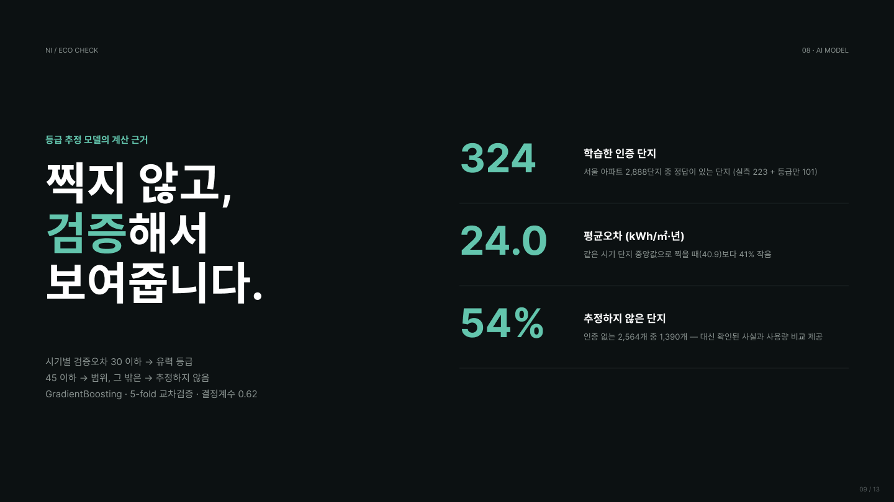

1. **건축물대장에 등급이 있으면** 그대로 사용합니다.
2. **서울 아파트**는 GradientBoosting 모델로 1차에너지소요량을 추정합니다. 준공 시기별 교차검증 오차에 따라 판정이 갈립니다.
   - 오차 ≤ 30 이고 실측 표본 8개 이상 → **등급**
   - 오차 ≤ 45 → **범위**
   - 그 밖, 또는 표본 8개 미만 → **추정 안 함**
3. **그 밖의 건물**은 같은 용도·사용승인 시기·규모의 실제 인증 사례를 8건 이상 모을 수 있을 때만 범위를 보여줍니다.

등급 한 칸의 폭이 30~40 kWh/m²·yr이라, 오차가 그보다 크면 등급을 말하는 순간 틀린 칸을 가리킬 수 있기 때문입니다.

| 항목 | 값 |
| --- | --- |
| 교차검증 MAE | 24.0 kWh/m²·yr (비교 기준 40.9 대비 41% 개선) |
| R² | 0.620 |
| 미인증 단지 2,564개 판정 | 등급 198 · 범위 976 · 추정 안 함 1,390 |

학습 과정과 시기별 결과는 [`model/README.md`](model/README.md)를 보세요.

<br>

## 사용 데이터

공공데이터 13종을 활용합니다.

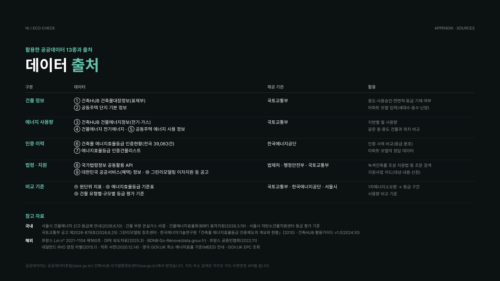

<br>

## 발표 자료

<details>
<summary>나머지 슬라이드 보기</summary>

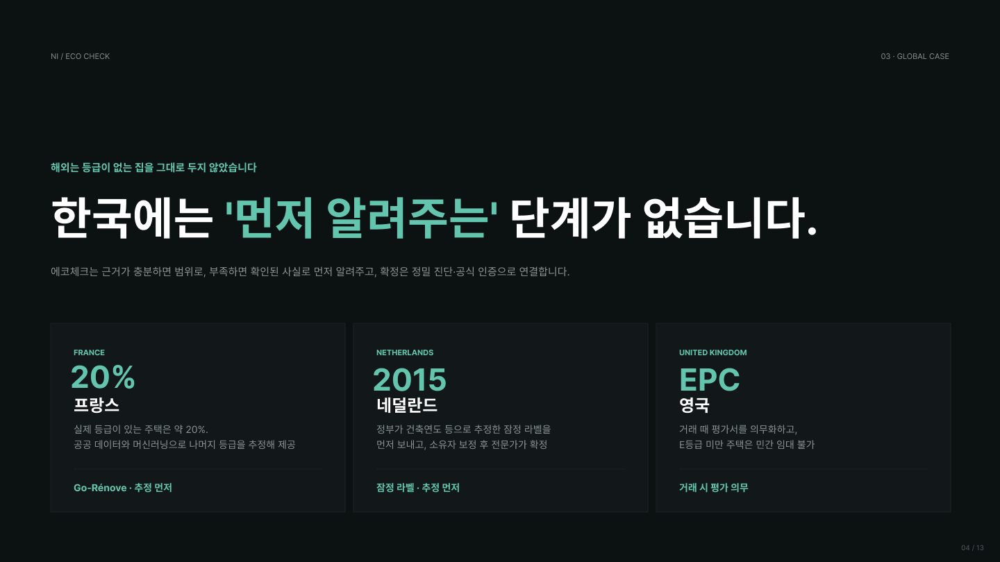
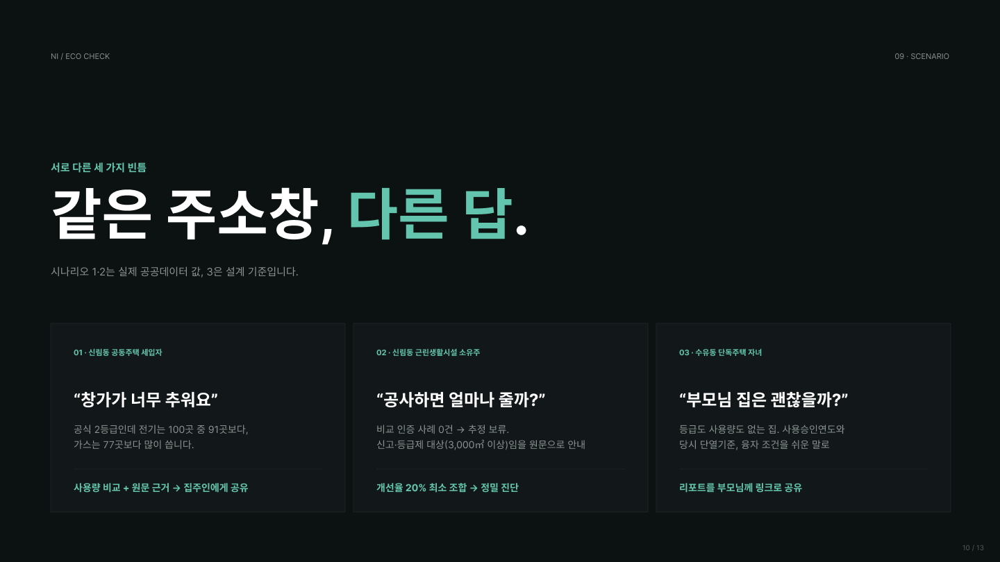
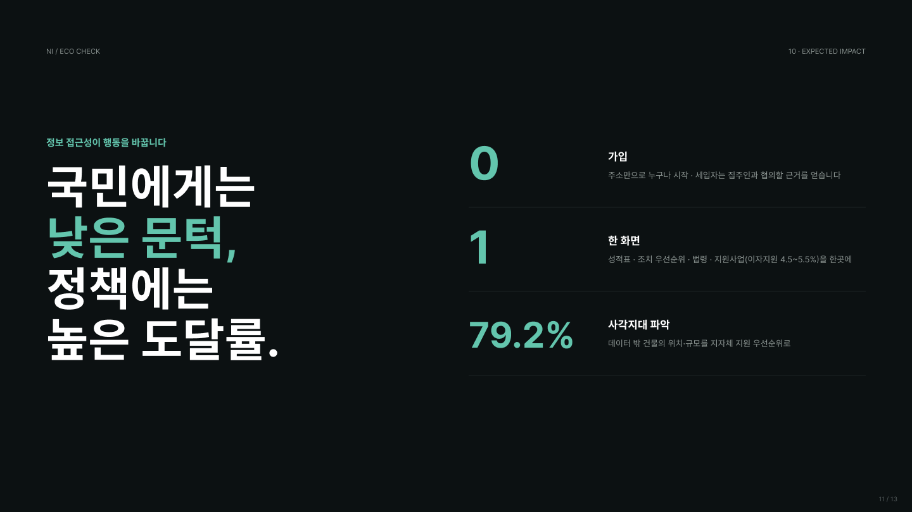
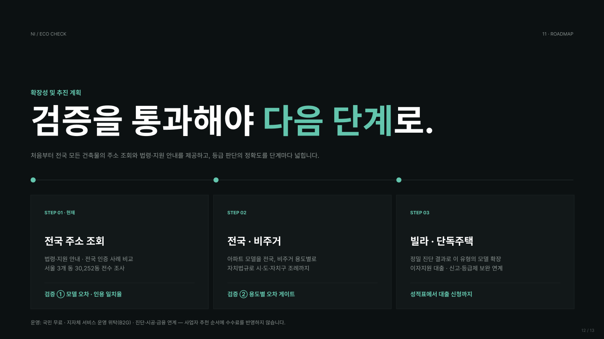
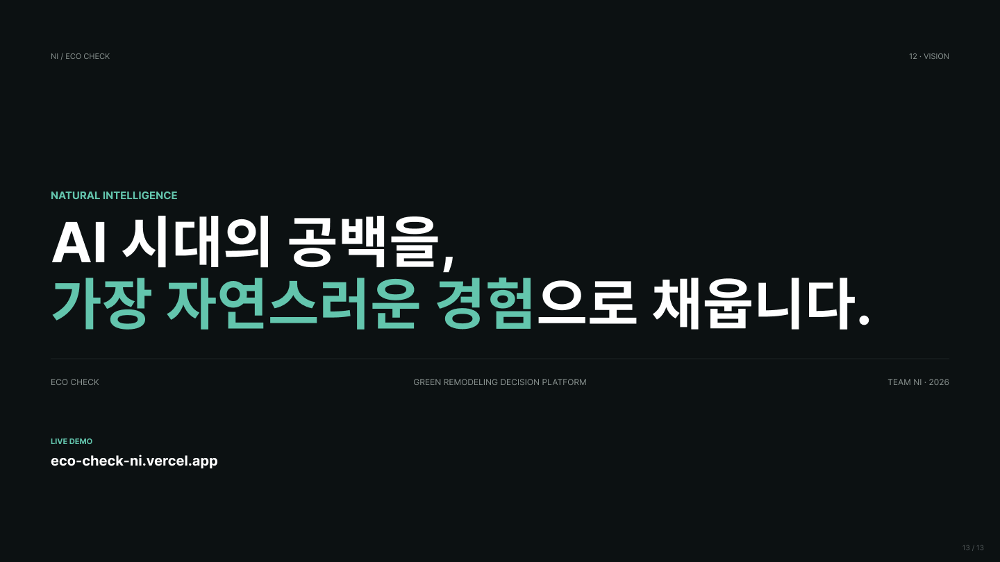

</details>

<br>

## 배포

백엔드는 Render(Docker, Root Directory `beec`), 프론트는 Vercel에 배포합니다. 절차와 시연 전 체크리스트는 [`DEPLOY.md`](DEPLOY.md)를 보세요.
